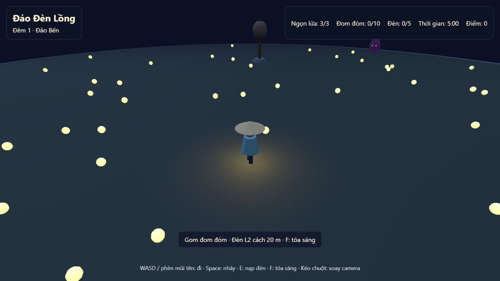

# Đảo Đèn Lồng — AI SDLC (Bản Phát Hành v1.0.0)

> **Video Demo Game:** [Xem Video Demo v1.0.0 (mp4)](https://github.com/MinDuck512/K5-L3A-DAY12-NguyenNgocMinhDuc-2A202603421-AI-SDLC-Dao-Den-Long/releases/tag/v1.0.0) hoặc [docs/demo/demo.mp4](docs/demo/demo.mp4)  
> **Phiên bản:** v1.0.0 (Phase 4 — Ticket-04, Test Contract **v1.3**)  
> **Nhóm/Tác giả:** 2A202603421 — Nguyễn Ngọc Minh Đức



---

## 1. Giới thiệu

**Đảo Đèn Lồng** là game phiêu lưu 3D góc nhìn thứ ba. Người chơi nhập vai **Mây** — người giữ đèn nhỏ tuổi, thu thập đom đóm rải rác trên các hòn đảo để thắp sáng và duy trì nhiên liệu cho các Đèn Lồng Lớn, né tránh và đẩy lùi Bóng Mực trong sương đêm để sống sót tới bình minh.

- **Đêm 1 (Đảo Bến):** Làm quen cơ chế gom đom đóm, thắp đèn và né Bóng Mực.
- **Đêm 2 (Hai đảo cầu tre):** Di chuyển qua cầu tre hẹp, dùng bục nhảy phóng qua đảo, bùa gió tăng tốc và đối phó Gió Lạc cướp đồ.
- **Đêm 3 (Đảo tháp chuông):** Địa hình dốc và bậc thềm, tháp chuông cao, gió lốc thổi mạnh định kỳ.

---

## 2. Yêu cầu hệ thống & Cài đặt

- **Yêu cầu:** Node.js >= 22.12.0, trình duyệt hỗ trợ WebGL 2 (Chrome, Edge, Firefox, Safari).
- **Cài đặt và chạy trong tối đa 2 lệnh:**

```bash
npm ci
npm run dev
```

Mở địa chỉ local hiển thị trên terminal (mặc định `http://127.0.0.1:5173`), nhấn **Bắt đầu**, đọc lời dặn của Ông Đăng và chọn **Vào Đêm**.

Đóng gói web tĩnh để phát hành:
```bash
npm run build
```
Thư mục web tĩnh sẵn sàng chạy tại `dist/`.

---

## 3. Điều khiển & Trợ năng (Accessibility)

### 3.1. Phím mặc định
| Phím | Hành động |
|---|---|
| **W, A, S, D** / Mũi tên | Di chuyển theo góc nhìn camera |
| **Kéo chuột** | Xoay góc nhìn camera xung quanh Mây |
| **Space** | Nhảy khi chạm đất |
| **Shift** | Lướt tốc độ cao (14 m/s trong 0,2 s; hồi 1,5 s; bỏ hồi chiêu khi có bùa) |
| **E** | Nạp đom đóm thắp đèn, châm thêm dầu hoặc thắp lại đèn đã tắt gần nhất |
| **F** | Tỏa Sáng (tốn 3 đom đóm; làm choáng 2s và đẩy lùi quái trong 5m; hồi 3s) |
| **Esc / P** | Tạm dừng trò chơi / Tiếp tục |

### 3.2. Tính năng Trợ năng
- **Đổi phím toàn diện:** Tùy biến toàn bộ phím điều khiển trong menu Cài đặt, tự động phát hiện và cảnh báo nếu bị trùng phím, có nút "Khôi phục mặc định". Phím lưu trên trình duyệt.
- **Phụ đề & Chỉ báo hình ảnh:** Cảnh báo bằng chữ và mũi tên mép màn hình khi Bóng Mực xuất hiện, cảnh báo gió mạnh sắp thổi, đếm ngược 10 giây cuối và thông báo khi đèn sắp cạn dầu (<30).
- **Giảm chuyển động (Reduce Motion):** Tắt rung camera, tắt chớp giật ánh sáng/màn hình.
- **Tùy chọn chữ lớn UI:** Tăng kích thước phông chữ lên 1.25 lần (mặc định >= 18px ở 1280×720).
- **Bảng màu dễ phân biệt:** Tối ưu hóa màu sắc cho người khiếm thị màu, lưu tự động.

---

## 4. Chế độ Kiểm chứng, Headless, Benchmark & Soak Test

### 4.1. Chạy toàn bộ kiểm chứng tự động (Verify)
```bash
npm run verify
```
Chạy 43 unit tests kiểm thử mọi cơ chế từ Phase 1 đến Phase 4 và tự động build Vite production.

### 4.2. Chế độ Headless CLI (Test Contract v1.3)
```bash
node src/headless.js --seed 1 --night 1 --scenario tests/scenarios/phase-3.json --inputs tests/scenarios/phase-3.inputs.json --ticks 120 --snapshot-every 60 --out output.jsonl
```

### 4.3. Chế độ Benchmark hiệu năng (Ticket-04)
```bash
node src/bench.js --seed 42 --duration 30 --out bench.json
```
- Tự động mở cảnh Đêm 1 với 200 Bóng Mực wander, 100 đom đóm, 3 đèn L1–L3 sáng.
- Camera xoay vòng tròn 360° bán kính 30m, đo đạc khung hình trong 30 giây.
- **Kết quả đo thực tế máy tác giả:** `avg_fps: 143.7` (ngưỡng >= 60), `p1_low_fps: 74.6` (ngưỡng >= 30), `load_ms: 680` (ngưỡng <= 10000). Xem chi tiết tại [bench.json](bench.json).

### 4.4. Soak Test độ bền & kiểm tra rò rỉ RAM (Ticket-04)
```bash
node src/soak.js --seed 7 --nights 10 --out soak.json
```
- Chạy headless 10 Đêm liên tiếp (Đêm 1 -> 2 -> 3 xoay vòng) trong cùng 1 tiến trình với input giả lập ngẫu nhiên theo seed.
- **Kết quả đo thực tế:** 0 crash, RAM 51 MB -> 58 MB (tăng 13.7%, đạt ngưỡng `<= 1.2 x RAM ban đầu`). Xem chi tiết tại [soak.json](soak.json).

### 4.5. Xuất Bảng xếp hạng CLI
```bash
node src/run.js --export-leaderboard leaderboard-export.json
```
Xuất danh sách top 10 người giữ đèn xuất sắc nhất ra file JSON theo chuẩn sắp xếp.

---

## 5. Sáng tạo của tôi (Rubric F)

Triển khai sáng tạo bám sát phần lõi yêu cầu và giữ nguyên Test Contract:
- **Tạo hình 3D hoàn toàn bằng mã (Procedural 3D):** Nhân vật Mây (áo nâu, nón lá, đèn nhỏ), 5 Đèn Lồng lớn (chao đèn, vết rách, lõi phát sáng), đom đóm hạt sáng và hiệu ứng vòng lan tỏa đều được dựng thuần bằng hình học Three.js, không phụ thuộc bất kỳ file texture hay 3D model bên ngoài.
- **Hệ thống âm thanh tổng hợp thời gian thực (Procedural Web Audio):** Toàn bộ nhạc nền và hiệu ứng âm thanh (nhặt đom đóm, thắp đèn, lướt, nhảy, tỏa sáng, cảnh báo gió, đếm ngược) được tổng hợp bằng Web Audio API trong `src/audio.js`, dung lượng cực nhẹ và không cần tải tệp âm thanh ngoài.
- **Tối ưu hóa hiệu năng:** Đạt trên 140 FPS trên màn hình kiểm tra, không gây giật lag và đảm bảo tương thích đa nền tảng. Xem thêm tại [CREDITS.md](CREDITS.md).

---

## 6. Hồ sơ SDLC & Tài liệu Bàn giao

- **Bản Retro tổng kết 4 phase:** [docs/RETRO.md](docs/RETRO.md)
- **Tiến độ và bằng chứng chi tiết:** [docs/progress.md](docs/progress.md)
- **Nhật ký thay đổi (Changelog 4 Phase):** [CHANGELOG.md](CHANGELOG.md)
- **Hợp đồng thông số game (Test Contract v1.3):** [game.contract.json](game.contract.json)
- **Quyết định kiến trúc ADR:** [docs/ADR-001-lantern-fuel-and-dawn.md](docs/ADR-001-lantern-fuel-and-dawn.md)
- **Nguồn tài nguyên và AI credits:** [CREDITS.md](CREDITS.md)
- **Giấy phép phần mềm:** [LICENSE](LICENSE)
